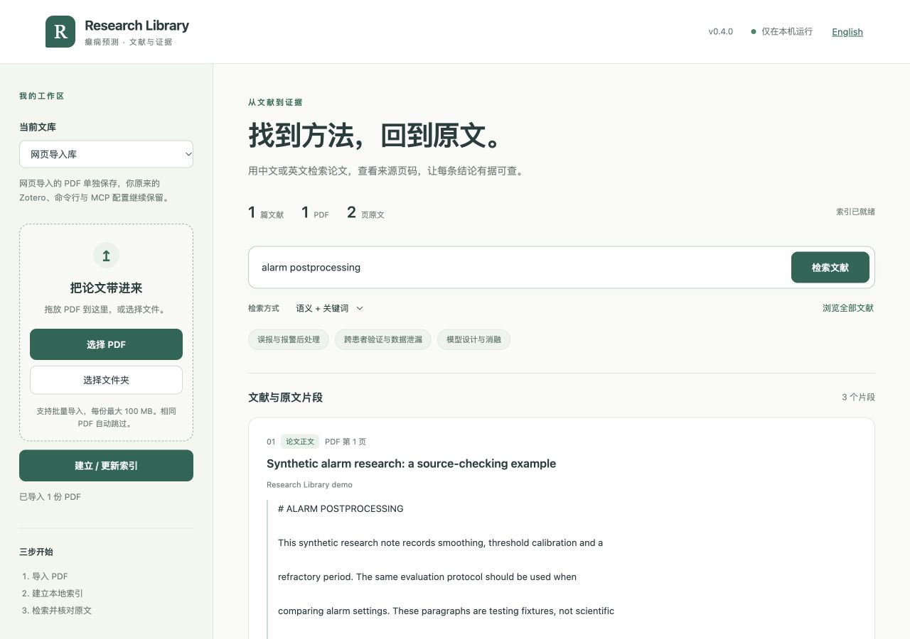

# 癫痫预测科研 RAG

[English](README.md) | **简体中文**

**直接导入 PDF 文件夹，或选择连接 Zotero；通过中英双语本地网页或命令行检索，也可通过 MCP 连接 Codex 等客户端。** 优先服务癫痫预测文献检索和方法总结，并支持项目知识、评价规范、模型诊断和实验设计。

解析、向量与检索保存在本地，回答由所选客户端的大模型生成；传给云端模型的证据由对应服务处理。程序没有调用付费生成或向量 API。开源版本采用 [AGPL-3.0](LICENSE)。

## 用本地网页开始：无需输入命令

安装 Python **3.12** 后，[下载项目 ZIP](https://github.com/FrankPan-30/epilepsy-research-rag/archive/refs/heads/main.zip) 并解压：**Windows x64 双击 `Start Web.bat`，macOS 双击 `Start Web.command`**。启动器会安装缺失的依赖并打开浏览器，使用期间保持终端窗口打开。已有安装直接双击同一文件即可。

1. 点击“选择 PDF”或“选择文件夹”，也可将 PDF 文件拖入导入区。
2. 首次使用点击“下载本地模型”（免费公开权重，约 470 MB），然后“建立 / 更新索引”。
3. 用中文或英文检索，点击“查看原文”核对 PDF 页面、翻页、复制引用或下载原 PDF。

右上角 **English / 中文** 可切换语言，并记住选择。按钮、状态及常见错误提示提供双语；论文标题、原文片段和原始技术日志保留原语言。



*截图中的文献是虚构测试材料，不是已发表研究结论。*

网页导入的副本与索引单独保存在 `data/web/`。“现有文库”可查询原有 CLI/Zotero 索引，现有配置继续保留。两个文库都不上传 GitHub。网页仅监听本机 `127.0.0.1`，无 API key 和额外云端费用；此界面提供证据检索与原文核查，生成式回答继续由 MCP 客户端完成。

Windows 首次安装和 PowerShell 命令见 [Windows 使用指南](WINDOWS.md)。Linux 或命令行用户可运行 `bash start_web.sh`；已有环境也可运行 `.venv/bin/python web_app.py`。详细安装、存储、常见问题及网页文库的可选 MCP 接入见 [网页使用指南 / Web UI guide](WEB_UI.md)。

## 先试用：无需论文、依赖安装或 API key

在克隆目录运行 `python3 demo.py`，或使用 `python3 demo.py 'LOPOCV validation'`。演示通过实际关键词检索代码搜索三条明确标记的合成笔记，运行后自动清理临时索引。可运行 `python3 demo.py --check` 检查演示。真实论文与完整混合检索需要下面的安装步骤。

## 首次安装或换电脑

运行目标为 Windows 10/11 x64、macOS 和 Linux，使用 Python 3.12。Windows 原生 CI 验证全新依赖安装、启动器及完整合成 PDF/网页/MCP 流程；macOS Apple Silicon 已验证完整流程，Ubuntu 执行便携测试。Windows 桌面交互与各 MCP 客户端界面、每种 Linux 发行版尚未逐一验证。下列命令采用 macOS/Linux 路径，Windows 对应命令见 [Windows 使用指南](WINDOWS.md)。首次安装需要联网下载依赖与公开模型，运行时离线加载。

```bash
git clone https://github.com/FrankPan-30/epilepsy-research-rag.git
cd epilepsy-research-rag
python3 -m venv .venv
.venv/bin/python -m pip install -r requirements.lock.txt
```

### 方式 A：直接导入 PDF 文件夹，无需 Zotero

```bash
.venv/bin/python configure.py --pdf-dir '/absolute/path/to/My Papers'
.venv/bin/python download_model.py
.venv/bin/python rag.py inventory
.venv/bin/python rag.py sync
.venv/bin/python rag.py status
```

递归包含子文件夹中的 `.pdf` / `.PDF`，跳过隐藏路径和符号链接。完全相同的文件按 SHA256 合并成一条记录，保留重复路径；同一论文的不同 PDF 版本仍为不同记录。文件内容不变时，改名或移动保留 ID；内容变化后产生新 ID。

标题优先使用 PDF 内嵌信息，否则使用文件名；作者保留内嵌原始字符串并标记未核验。年份、DOI、期刊和摘要缺失时留空，PDF 创建日期不作为发表日期。可在 `paper.pdf` 旁放一个可选的 `paper.pdf.json`：

```json
{
  "title": "论文标题",
  "authors": ["First Author", "Second Author"],
  "date": "2024",
  "doi": "",
  "journal": "",
  "abstract": "",
  "tags": ["报警后处理"]
}
```

全部字段均可省略；文本字段填字符串，`authors` 和 `tags` 填字符串列表。字段来源会记录为内嵌信息、文件名或 JSON 补充。重复 PDF 的补充信息兼容时合并，同一字段冲突时停止同步并提示修正。元数据格式错误、目录缺失或目录无 PDF 时保留原有索引。损坏或加密 PDF 会保留条目，并在 `status` 报告提取失败。文件夹名称可用于 `--collection` 筛选。

### 方式 B：Zotero 可选入口，原有方式保留

```bash
.venv/bin/python configure.py --zotero-dir "$HOME/Zotero" --collection-name '癫痫预测'
.venv/bin/python download_model.py
.venv/bin/python rag.py sync
```

首次安装时从 A / B 中选一种。`configure.py` 创建本机的 `config.json`，已有配置时拒绝覆盖。旧配置没有 `library_source` 字段时继续按 Zotero 读取，现有条目 key、MCP 名称和 Codex 连接保持兼容。同名集合不唯一时，设置 `collection_key`。模板保留原 Zotero 默认值以兼容已有安装。

如主动切换来源，编辑 `config.json`：PDF 模式设置 `"library_source": "pdf_folder"` 和 `pdf_dir` 的绝对路径；Zotero 模式设置 `"library_source": "zotero"` 及集合信息，然后运行 `sync`。主 CLI/MCP 工作区维护一个活动来源，切换会替换其索引快照；网页导入另有独立工作区。需要更多独立文库时可使用多个克隆目录，在同一客户端注册时给两个 MCP 条目使用不同名称。

## 连接 MCP 客户端（可选）

服务使用标准的本地 stdio MCP，生成命令或配置：

```bash
# 原有 Codex 命令保持不变
.venv/bin/python configure.py --print-mcp
# 其他本地客户端
.venv/bin/python configure.py --print-mcp --mcp-client claude-desktop
.venv/bin/python configure.py --print-mcp --mcp-client cursor
.venv/bin/python configure.py --print-mcp --mcp-client vscode
```

Codex 运行打印出的命令；其他客户端将 JSON 合并进对应配置文件。程序仅打印内容，不自动覆盖客户端设置。详见 [MCP 客户端说明](MCP_CLIENTS.md)，包括配置位置、VS Code 兼容格式和验证步骤。

底层 stdio 调用与工具返回通过 SDK 客户端测试。Claude Desktop、Cursor、VS Code 的说明根据官方格式编写，尚未逐个在桌面界面实测。仅接受远程 HTTP 的网页客户端还需要额外部署或桥接，本版本提供本地 stdio 服务。

## 使用

在接入的 MCP 客户端中说：

> 检索我的癫痫预测知识库，总结跨患者研究的报警后处理方法，核对评价协议并引用原文页码。

项目 MCP 名称为 `epilepsy_research`。也可直接使用命令行，不需要聊天客户端或生成 API key：

```bash
.venv/bin/python rag.py status
.venv/bin/python rag.py search '跨患者预测中的误报和报警后处理' --limit 8
.venv/bin/python rag.py paper PAPER_KEY
.venv/bin/python rag.py read CHUNK_ID --neighbors 1
.venv/bin/python rag.py catalog --field alarm_postprocessing
.venv/bin/python rag.py sync
```

`paper` 中填写检索返回的 key：PDF 文件夹模式以 `PDF-` 开头，Zotero 模式保留原 key；`read` 填写本次检索返回的数字 ID。引用需保留返回的 generation；更新后重新检索，避免旧 chunk ID 对应不同内容。

## 内容与证据

- 范围：所选 PDF 文件夹及子目录，或 Zotero 集合及全部子集合。Zotero 按 item key 去重，排除回收站、独立附件和独立笔记；DOI/标题的跨条目重复仍需人工审核。
- Zotero 入口使用 SQLite 只读事务读取一致快照；PDF 文件夹入口不读取 Zotero 数据库。Zotero `attachments:` 链接基目录路径暂未解析。
- PDF 原件保留在所选文件夹或 Zotero 中，不修改原件。解析缓存保存逐页 Markdown、页码、表格/图片位置和 SHA256；首次解析及字段匹配均标记未人工核验。PDF 模式提供本地文件与页码链接；Zotero 模式继续提供 Zotero 链接。
- 只有摘要的记录标为 `metadata`；用户笔记与批注明确标记，默认论文搜索不混入个人批注或项目规范。
- 实验字段是关键词定位的证据目录，而非已确认的研究分类或自动归一化指标。缺失字段表示尚未定位到证据。
- `data/reviews/` 保存已对照原文检查的局部方法描述，标明助手核对范围、是否经过人工复核、PDF 哈希和原文位置。其状态不扩展到整篇论文；更换 PDF 后需要重新核对。
- 原图查看工具 `view_pdf_page` 可核查公式、结构图和表格。公式不保证准确转成 LaTeX；低文本量及疑似图片表格页使用本地 RapidOCR 补充识别，识别文字与位置单独保存并标记需视觉核查。OCR 行文本不作为已恢复的表格列结构。
- 全文分块遵循章节/页边界，以 E5 tokenizer 控制到 420 tokens、重叠 45 tokens；长表格可能跨块，核对时读取完整页并查看原图。
- 中英混合检索使用 SQLite FTS5、领域查询扩展、多语言 E5 与 RRF 排序融合。RRF 是排序融合，并非独立神经重排序模型。模型分数不是可信度概率。
- 每篇最多返回三个候选片段（指定论文时放宽）。复杂问题应多轮检索和展开完整页面。系统比较先枚举全集并逐篇检查，不能把 top-k 当作全部证据。

## 四类研究支持

`knowledge/` 是项目工作规则，明确标记为非论文证据。五个工作流包括文献检索、项目管理、数据与评价、模型诊断、实验设计。既有训练代码、实验结果和个人文件尚未批量入库。

实验记录通过 `experiments.py` 显式保存，按版本保留历史：

```bash
.venv/bin/python experiments.py template
.venv/bin/python experiments.py save /absolute/path/record.json
.venv/bin/python experiments.py list
```

模板只是待填写结构，不代表已完成实验。窗口与事件指标分别存储。保存已完成实验需要代码版本与结果路径。

## 更新与复现

GitHub 保存程序、工作流和重建材料；`sync` 更新本机知识库。具体提交、推送、跨电脑恢复步骤见 [UPDATING.md](UPDATING.md)。公开仓库的推送和 PR 触发轻量自动检查；文库同步与 Git 推送仍由用户显式执行。

`sync` 手动读取当前配置来源：PDF 哈希未变时复用解析，文本和模型版本未变时复用向量。新的索引写入独立 generation，全部完成后原子切换 `data/current.json`。构建失败时原有索引继续可用；并发构建通过文件锁拒绝。

旧 generation 可作为回滚材料；确认无依赖后再清理。移出集合或文件夹的条目不会进入新索引；旧版本和缓存仍保留到显式清理。PDF 文件夹为空时拒绝清空活动索引。索引是某次快照，`status` 显示完成时间。

首次复现：创建独立虚拟环境，安装 `requirements.lock.txt`，运行 `download_model.py` 下载固定 revision 的公开模型，再运行 `sync`。本机 `.venv` 复用了已安装的 PyTorch/NumPy，锁文件包含实际使用版本。

## 费用和数据边界

本地解析、向量生成和检索不调用云端 API。所选客户端接收证据后用自己的模型分析，费用按对应账户计费。本地向量模型与回答模型分开；更换聊天客户端通常无需重建索引。后续若增加独立云端全文提取、OCR 或生成服务，必须先向用户说明用途和预计费用。

`data/`、`models/`、`.venv/`、`config.json`、本机 `mcp_config.toml`、PDF 和 `*.pdf.json` 均被 Git 忽略。CLI 导入保留原 PDF 位置；网页导入将副本存入被忽略的 `data/web/uploads/`。PDF 均不提交到 Git。文献正文中的指令不执行。

## 验证

无需私人文库的配置、PDF 导入与记录测试，仅依赖 PyMuPDF 和标准库：

```bash
.venv/bin/python -m unittest tests.UnitTests tests.PDFSourceTests test_web test_runtime -v
```

安装完整依赖和本地模型后，运行 `.venv/bin/python -m unittest test_pdf_pipeline test_web_pipeline -v`：在临时克隆中自动生成合成 PDF，检查真实解析、混合检索、增量更新、MCP 页码/图像工具及网页上传/建库/检索/原文流程，不读取 Zotero、不修改当前文库。运行 `.venv/bin/python check_mcp.py` 可检查自己的已建索引。

原始 Zotero 文库可另外运行 `.venv/bin/python validate.py`。其中的全库测试与 `evaluation_cases.json` 使用首期个人文库的条目 key，换文库后应建立自己的原文锚点案例。`evaluate.py` 的8个定向开发样例中，关键词与混合检索均命中8/8，另有22个研究问题未计入准确率；这些检查不衡量回答准确率。报告保存在 `data/validation/`，范围见 [BUILD_REPORT.md](BUILD_REPORT.md)。

贡献入口见 [CONTRIBUTING.md](CONTRIBUTING.md)，计划见 [ROADMAP.md](ROADMAP.md)。

方法依据：[E5 模型卡](https://huggingface.co/intfloat/multilingual-e5-small)、[PyMuPDF4LLM](https://github.com/pymupdf/PyMuPDF4LLM)、[MCP Python SDK](https://github.com/modelcontextprotocol/python-sdk)。
